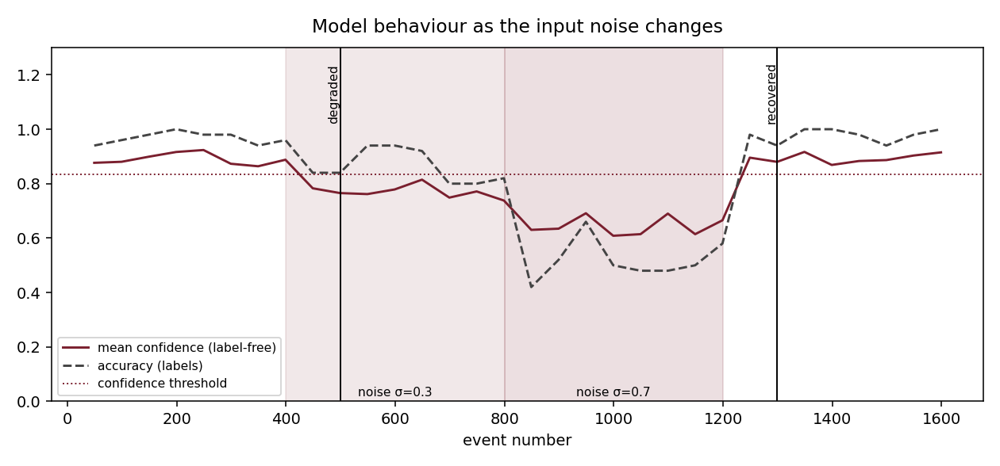
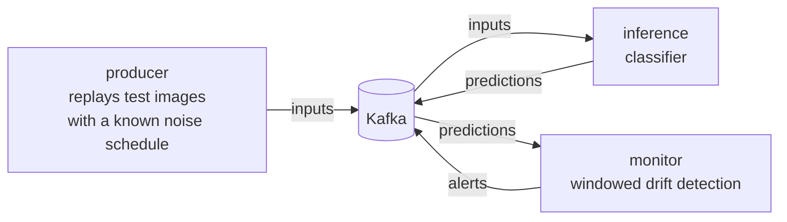

# Streaming robustness monitor

[](https://github.com/BrainCoder3/streaming-robustness-monitor/actions/workflows/ci.yml)

A small **Apache Kafka** pipeline, run with **Docker Compose**, that watches an image classifier while the quality of its inputs degrades, and raises an alert **without using the true labels**.

It extends a question from my own noise-robustness experiments (Whisper, 3D-CNN, RobustCLIP-Lite): *how do we notice, in operation, that a model has started to fail because its environment changed?*



## How it works



- **producer**: streams 1 600 images, degraded by Gaussian noise in four phases (clean, σ = 0.3, σ = 0.7, clean again). The noise level is only used for the evaluation, the monitor never reads it.
- **inference**: reads `inputs`, predicts, writes `predictions` with the label and the confidence (highest class probability).
- **monitor**: reads `predictions` by windows of 50 events. A window is *bad* if the mean confidence is below `baseline − 3·σ/√50`, or if the accuracy (when labels are available) falls 10 points under the baseline. It raises `DEGRADED` after 2 bad windows in a row and `RECOVERED` after 2 good ones, so a single unlucky window does not trigger anything.

The three stages only talk to the message bus (`src/robustmon/bus.py`). The same code runs on an in-memory bus (tests, offline demo) and on a real Kafka broker.

## Run it

**Offline demo, no Docker, no Kafka** (the pipeline runs in one process and writes the figure above):

```bash
pip install -r requirements.txt
PYTHONPATH=src python -m robustmon demo
```

**Full pipeline with Kafka and Docker Compose**:

```bash
docker compose up --build
docker compose logs -f monitor     # the alerts appear here
```

**Tests**:

```bash
pip install pytest
python -m pytest -q
# against a real broker (after `docker compose up -d kafka`):
KAFKA_BOOTSTRAP=localhost:9094 python -m pytest tests/test_kafka_integration.py
```

## Results (simulation, 20 random seeds)

| Measure | Result |
|---|---|
| False alarms during the first clean phase | 0 in 20 runs |
| Detection delay after the noise starts | 100 events in every run (the floor set by 2 windows × 50 events) |
| Recovery delay after the noise stops | 100 events in every run |
| Clean test accuracy of the model | 97.2 % |

The mild noise (σ = 0.3) is already detected, before the model is clearly wrong: the confidence moves first, which is exactly why a label-free signal is useful.

## Verification

The full stack was run with Docker Compose (Docker Desktop 4.99, engine 29.9.3, Windows 11) on 12 November 2026:

- the three topics received **1 600 `inputs`, 1 600 `predictions` and 2 `alerts`**;
- the monitor logged `DEGRADED` after event 499 and `RECOVERED` after event 1 299, **identical to the offline demo** (same code, different bus);
- `tests/test_kafka_integration.py` passes against the running broker (`KAFKA_BOOTSTRAP=localhost:9094`).

## Limits

- The data is the scikit-learn **digits** set (8×8 images) and the noise is synthetic Gaussian noise. This is a controlled setting to study the monitoring layer, not a claim about real production data.
- Detection is a simple statistical rule on confidence and accuracy. It is not a trained drift detector, and a model can be confidently wrong.
- A single-node Kafka broker with replication factor 1: enough to learn and demonstrate the pipeline, not a resilient deployment.
- The detection delay is dominated by the window size and the number of consecutive windows; shorter windows react faster but raise more false alarms.

## What this repository shows

| Skill | Where |
|---|---|
| Apache Kafka (topics, consumer groups, offsets, producers) | `src/robustmon/bus.py`, `docker-compose.yml`, `tests/test_bus.py` |
| Docker and Docker Compose (image, multi-service stack, health check, one image for three roles) | `Dockerfile`, `docker-compose.yml` |
| Git and GitHub (history, CI with GitHub Actions: tests on two Python versions, image build, container smoke test) | `.github/workflows/ci.yml` |
| Testing a streaming system without a broker (same interface, in-memory implementation) | `tests/` |

## En français

Un pipeline **Apache Kafka** déployé avec **Docker Compose** qui surveille un classifieur d'images pendant que la qualité des entrées se dégrade, et qui déclenche une alerte **sans utiliser les vraies étiquettes**, à partir de la confiance du modèle. Il prolonge mes expériences de robustesse au bruit (Whisper, CNN 3D, RobustCLIP-Lite). Démo hors ligne : `PYTHONPATH=src python -m robustmon demo`. Pipeline complet : `docker compose up --build`.
